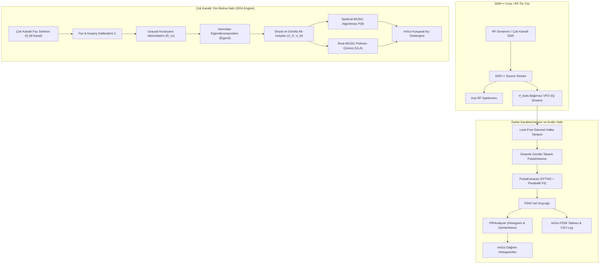
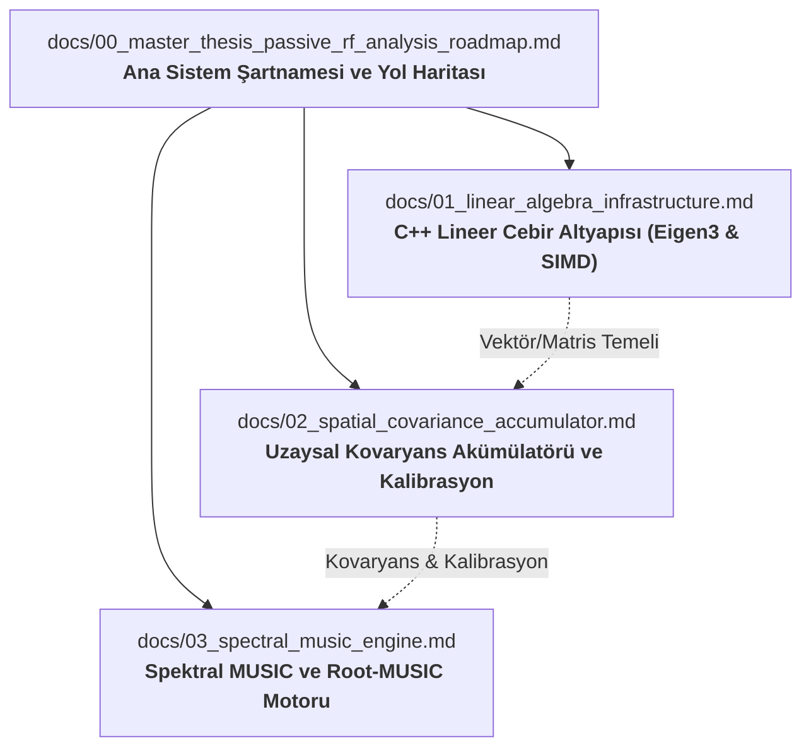

# Gerçek Zamanlı Pasif RF Analizi ve Alt-Uzay Tabanlı Yön Bulma Mimarisi
## SDR++ Ekosisteminde C++17 ile Yüksek Başarımlı Sinyal Karakterizasyonu ve DOA Kestirimi

**Yazar:** Süleyman Poyraz  
**Proje:** `rf_tools` Module for SDR++  
**Tarih:** Ekim 2026  
**Doküman Kodu:** SDRPP-RF-DOC-00  

---

### Özet (Abstract)
Yazılım Tanımlı Radyo (Software Defined Radio - SDR) mimarileri, RF spektrumunun geniş bantta izlenmesi ve heterojen sinyallerin çözümlenmesi için maliyet-etkin ve esnek donanım platformları sunmaktadır. Ancak mevcut açık kaynaklı SDR masaüstü altyapılarında (özellikle SDR++ gibi modüler C++ altyapılarında), darbe parametrelerinin gerçek zamanlı çıkarımı (Pulse Descriptor Word - PDW), Darbe Tekrarlama Aralığı (Pulse Repetition Interval - PRI) örüntü tasnifi ve çok kanallı yön bulma (Direction of Arrival - DOA) analizlerini doğrudan yerel (native) C++ DSP katmanında gerçekleştiren tümleşik bir pasif sinyal işleme mimarisi bulunmamaktadır. GNU Radio gibi mevcut araştırma araçları, Python çatı bağımlılıkları, prosesler arası iletişim maliyetleri ve yüksek işlem gecikmeleri sebebiyle gerçek zamanlı tespit ve anlık yön kestirimi uygulamalarında performans darboğazı oluşturmaktadır.

Bu yüksek lisans tez/teknik spesifikasyon çalışmasında; SDR++ çekirdeğiyle tam entegre, harici çalışma zamanı (runtime) bağımlılığı içermeyen, SIMD (Tek Komut, Çok Veri) vektörel hızlandırma ve modern C++17 prensiplerine dayalı yüksek başarımlı bir **Pasif RF Analiz ve Alt-Uzay Tabanlı Yön Bulma Mimarisi (`rf_tools`)** tasarlanmış ve geliştirilmiştir. Çalışma, iki ana araştırma ve geliştirme eksenini kapsamaktadır: (i) Otomatik gürültü tabanı takibi ve histerezisli eşikleme ile mikrosaniye altı çözünürlükte darbe parametre çıkarımı (PW, TOA, alt-sepet frekans enterpolasyonu, SNR) ile istatistiksel PRI kümeleme motoru; (ii) Çok kanallı eşzamanlı SDR dizilerinden elde edilen IQ anlık görüntülerinin (snapshots) kovaryans matrisinin ($R_{xx}$) gerçek zamanlı birikimi, faz/kazanç kalibrasyonu ve alt-uzay tabanlı süper-çözünürlüklü Spektral MUSIC ve Root-MUSIC yön kestirim algoritmaları. Bu doküman; kuramsal temelleri, matematiksel formülasyonları, C++ yazılım mimarisini, sentetik/gerçek doğrulama metodolojisini ve kapsamlı literatür atıflarını içeren ana sistem şartnamesini sunmaktadır.

---

## 1. Giriş ve Kuramsal Kapsam (Introduction & Scope)

### 1.1 Problem Tanımı ve Motivasyon
Modern RF harp ortamı ve spektrum gözetim sistemleri, mikrosaniye ve nanosaniye seviyelerinde yayın yapan radarlar, transponderlar (ör. ADS-B Mod-S), telemetri bağlantıları ve taktik veri bağları ile son derece yoğun bir elektromanyetik spektrumda icra edilmektedir. Bu platformların tespit, teşhis ve lokalizasyonunda iki temel görev icra edilir:
1. **Darbe Karakterizasyonu (Pulse Parameter Extraction):** Zaman domeninde tespit edilen her bir RF darbesinin gelişi (TOA), genişliği (PW), darbe içi tepe/ortalama gücü, sinyal-gürültü oranı (SNR) ve merkez frekansı kestirilerek Darbe Tanımlama Kelimesi (PDW) oluşturulur.
2. **Yön Kestirimi (Direction of Arrival - DOA):** Alıcı anten dizisinin uzaysal açıklığı boyunca gelen dalga cephesinin oluşturduğu faz farklarından yararlanılarak hedef vericinin azimut ve elevasyon açıları alt-uzay ayrıştırma teknikleriyle süper-çözünürlüklü olarak kestirilir.

Mevcut akademik ve endüstriyel çözümler ekseriyetle GNU Radio blokları (`gr-pdw` [1], `gr-doa` [2]) veya çevrimdışı MATLAB simülasyonları üzerine inşa edilmiştir. GNU Radio blokları araştırma için esnek olmakla birlikte:
- Modül başına Python sarmalayıcıları ve dinamik bellek tahsisleri,
- CPU önbellek (cache) yerelliğini bozan akış tabanlı tampon kopyalamaları,
- Yüksek bant genişliklerinde (örn. $\ge 10\text{ MS/s}$) gerçek zamanlı tampon taşmaları (overflow),
- SDR++ gibi düşük gecikmeli, donanım hızlandırmalı OpenGL/ImGui arayüzüne sahip modern alıcılarla entegrasyon eksikliği gibi yapısal kısıtlar taşımaktadır.

`rf_tools` projesinin temel amacı; bu algoritmaları saf C++17, Eigen3 matris cebiri ve SIMD vektörizasyon altyapısıyla yeniden formüle ederek doğrudan SDR++ çekirdeğine gömülü, sıfır-kopyalama (zero-copy) prensibiyle çalışan bir pasif RF analiz motoru sunmaktır.

### 1.2 Kapsam ve Sınırlar
- **Kapsam İçi:**
  - Bağımsız 2 MHz (veya kullanıcı tanımlı) VFO üzerinden darbe algılama, histerezisli eşik denetimi ve dinamik CFAR benzeri gürültü tabanı izleme.
  - Alt-sepet parabolik tepe enterpolasyonlu FFTW3 frekans kestirimi ve PDW üretimi.
  - Histogram tabanlı istatistiksel PRI analizi (Sabit, Kademeli/Stagger, Seğirmeli/Jitter tasnifi).
  - Çok kanallı alıcı dizileri için uzaysal kovaryans matrisi akümülasyonu ($R_{xx}$).
  - Spektral MUSIC ve Düzgün Doğrusal Dizi (ULA) için Root-MUSIC yön bulma motoru.
  - Antenler arası faz ve genlik dengesizliklerini telafi eden kalibrasyon katmanı.
  - ImGui tabanlı gerçek zamanlı kutupsal (polar) yön bulma ve PDW görselleştirme arayüzü.
- **Kapsam Dışı:**
  - Çoklu darbe katarı ayrıştırma (deinterleaving) aşamasında çok boyutlu kümeleme (PRI, frekans ve açı uzayında tam füzyonlu emitter clustering bir sonraki fazdır).
  - Verici kimlik doğrulama / tehdit kütüphanesi veri tabanı eşleştirmesi.
  - Alıcı donanımının RF ön yüz saat senkronizasyonunun (PPS/10 MHz referans) donanımsal üretimi (mevcut senkron SDR donanımları veya harici saat dağıtıcılar varsayılmaktadır).

---

## 2. Sistem Mimarisi ve Matematiksel Modeller (System Architecture & Theory)

Aşağıdaki blok diyagram, SDR++ içerisinde çalışan `rf_tools` modülünün veri akışını ve sinyal işleme boru hattını (pipeline) özetlemektedir:

### 2.1 Darbe Tespiti ve Parametre Çıkarım Matematiği
Seçilen VFO'dan gelen karmaşık taban bant sinyali $x[n] = I[n] + jQ[n]$ olmak üzere, anlık güç:
$$p[n] = |x[n]|^2 = I[n]^2 + Q[n]^2$$

Dinamik gürültü tabanı kestirimi ($\sigma_w^2$), darbe dışı aralıklarda tek kutuplu üstel hareketli ortalama (EMA) filtresi ile güncellenir:
$$\sigma_{w}^2[n] = (1 - \alpha) \, \sigma_{w}^2[n-1] + \alpha \, p[n], \quad \alpha \ll 1$$

Algılama eşiği $\gamma_{\text{start}} = \sigma_w^2 \cdot 10^{\Delta_{\text{margin}}/10}$ olarak belirlenir. Darbe bitişinde yanlış bölünmeleri engellemek amacıyla histerezis eşiği uygulanır:
$$\gamma_{\text{stop}} = \gamma_{\text{start}} \cdot 10^{-3/10} \approx 0.5 \, \gamma_{\text{start}} \quad (\text{3 dB histerezis})$$

Darbe içi frekans ofseti $\Delta f$, $N_{\text{FFT}}$ uzunluğunda sıfır-dolgulu (zero-padded) FFT alınarak ve spektral tepe noktası $k_{\text{peak}}$ etrafında parabolik tepe enterpolasyonu yapılarak hesaplanır:
$$\delta = \frac{1}{2} \frac{\ln |X[k_{\text{peak}}-1]| - \ln |X[k_{\text{peak}}+1]|}{\ln |X[k_{\text{peak}}-1]| - 2\ln |X[k_{\text{peak}}]| + \ln |X[k_{\text{peak}}+1]|}$$
$$f_{\text{est}} = f_{\text{VFO}} + \left(k_{\text{peak}} + \delta\right) \frac{f_s}{N_{\text{FFT}}}$$

### 2.2 Uzaysal Dizi Sinyal Modeli ve Kovaryans Matrisi
$M$ elemanlı bir anten dizisine uzaktaki $D$ adet dar bantlı kaynaktan gelen dalga cepheleri için dizi anlık vektörü:
$$\mathbf{x}[n] = \sum_{i=1}^D \mathbf{a}(\theta_i) s_i[n] + \mathbf{w}[n] = \mathbf{A}(\boldsymbol{\theta})\mathbf{s}[n] + \mathbf{w}[n]$$
Burada $\mathbf{a}(\theta)$ anten dizisinin yönlendirme vektörü (steering vector), $\mathbf{w}[n] \sim \mathcal{CN}(\mathbf{0}, \sigma^2 \mathbf{I})$ uzaysal beyaz Gauss gürültüsüdür. Düzgün Doğrusal Dizi (ULA) için antenler arası mesafe $d = \lambda / 2$ olduğunda:
$$\mathbf{a}(\theta) = \begin{bmatrix} 1 & e^{-j 2\pi \frac{d}{\lambda} \sin\theta} & \dots & e^{-j (M-1) 2\pi \frac{d}{\lambda} \sin\theta} \end{bmatrix}^T$$

$K$ adet anlık görüntü üzerinden örneklem uzaysal kovaryans matrisi $\hat{\mathbf{R}}_{xx} \in \mathbb{C}^{M \times M}$:
$$\hat{\mathbf{R}}_{xx} = \frac{1}{K} \sum_{n=1}^K \mathbf{x}[n] \mathbf{x}^H[n]$$
olarak hesaplanır. $\hat{\mathbf{R}}_{xx}$, Hermitian pozitif yarı-tanımlı matristir.

### 2.3 Alt-Uzay Ayrıştırması ve Süper-Çözünürlüklü Açı Kestirimi
$\hat{\mathbf{R}}_{xx}$ matrisinin özdeğer ayrışımı (EVD):
$$\hat{\mathbf{R}}_{xx} = \mathbf{U} \mathbf{\Lambda} \mathbf{U}^H = \begin{bmatrix} \mathbf{U}_S & \mathbf{U}_N \end{bmatrix} \begin{bmatrix} \mathbf{\Lambda}_S & \mathbf{0} \\ \mathbf{0} & \mathbf{\Lambda}_N \end{bmatrix} \begin{bmatrix} \mathbf{U}_S^H \\ \mathbf{U}_N^H \end{bmatrix}$$
Burada $\mathbf{\Lambda}$ özdeğerleri azalan sırada dizilmiştir: $\lambda_1 \ge \dots \ge \lambda_D > \lambda_{D+1} = \dots = \lambda_M = \sigma^2$. $\mathbf{U}_S \in \mathbb{C}^{M \times D}$ sinyal alt-uzayını, $\mathbf{U}_N \in \mathbb{C}^{M \times (M-D)}$ ise gürültü alt-uzayını temsil eder.

#### Spektral MUSIC (Schmidt, 1986 [5])
Sinyal yönlendirme vektörleri teorik olarak gürültü alt-uzayına diktir ($\mathbf{a}^H(\theta_i) \mathbf{U}_N = \mathbf{0}$). Buradan hareketle MUSIC uzaysal sözde-spektrumu:
$$P_{\text{MUSIC}}(\theta) = \frac{1}{\mathbf{a}^H(\theta) \mathbf{U}_N \mathbf{U}_N^H \mathbf{a}(\theta)}$$
formülüyle taranır. $P_{\text{MUSIC}}(\theta)$ fonksiyonunun yerel tepe noktaları geliş açılarını verir.

#### Root-MUSIC (Barabell, 1983 [6])
Spektral tarama maliyetini ortadan kaldırmak için $z = e^{-j 2\pi \frac{d}{\lambda} \sin\theta}$ değişken dönüşümü yapılarak birim çember üzerindeki kökler aranır:
$$P(z) = \mathbf{a}^T(z^{-1}) \mathbf{C} \, \mathbf{a}(z) = 0, \quad \text{burada } \mathbf{C} = \mathbf{U}_N \mathbf{U}_N^H$$
$2(M-1)$ dereceli bu polinomun birim çemberin hemen içinde kalan ve birim çembere en yakın $D$ adet kökü $z_i = r_i e^{j\psi_i}$ tespit edilir. Buradan geliş açısı doğrudan analitik olarak bulunur:
$$\theta_i = \arcsin\left( -\frac{\lambda}{2\pi d} \arg(z_i) \right)$$

---

## 3. Alt Sistem Dokümantasyon Planı (Detailed Specifications)

Sistemin üç kritik teorik ve algoritmik yapıtaşı, bu ana yol haritası ile eşgüdümlü olarak bağımsız teknik şartname dokümanları halinde ayrıntılandırılmıştır:

1. [C++ Modern Lineer Cebir Altyapısı](file:///Users/zaryob/Development/SDRPlusPlus/docs/01_linear_algebra_infrastructure.md):
   - Sabit boyutlu karmaşık matris (`Eigen::Matrix<std::complex<float>, M, M>`) bellek hizalama (128/256-bit SIMD).
   - `SelfAdjointEigenSolver` ile Hermitian EVD işlemci mimarisi, Householder indirgemesi, sayısal kararlılık ve döngü gecikme analizleri.
   - Lock-free dairesel tamponlar ve gerçek zamanlı ses/video DSP thread kısıtları altında deterministik bellek yönetimi.
2. [Uzaysal Kovaryans Akümülatörü ve Dizi Kalibrasyonu](file:///Users/zaryob/Development/SDRPlusPlus/docs/02_spatial_covariance_accumulator.md):
   - $R_{xx}$ matrisinin sonlu anlık görüntü (finite snapshots) altında istatistiksel sapmaları ve Wishart dağılımı.
   - Durağan olmayan ortamlar için üstel unutma faktörlü (recursive exponential forgetting) çevrimiçi güncelleme formülasyonu.
   - Çok kanallı SDR platformlarında (KrakenSDR, USRP TwinRX) faz/kazanç dengesizlikleri ve karşılıklı kuplaj (mutual coupling) kalibrasyon modeli.
   - Uyumlu (coherent) çokyollu sinyalleri çözmek için İleri-Geri Uzaysal Düzeltme (Forward-Backward Spatial Smoothing - FBSS) algoritması.
3. [Spektral MUSIC ve Root-MUSIC Yön Bulma Motoru](file:///Users/zaryob/Development/SDRPlusPlus/docs/03_spectral_music_engine.md):
   - Sinyal/gürültü alt-uzay ayrıştırma geometrisi ve model derecesi kestirimi (AIC/MDL kriterleri).
   - Spektral MUSIC ızgara tarama ve parabolik interpolasyon ile 0.1° altı açı çözünürlüğü.
   - Root-MUSIC polinom oluşturma, eşlik matrisi (companion matrix) özdeğerleri üzerinden kök ayıklama ve "kök takası" (root-swap) anomalilerinin engellenmesi.
   - Açı kestirim hatasının teorik Cramér-Rao Alt Sınırı (CRLB) ile analitik kıyaslaması.

---

## 4. Uygulama ve Doğrulama Yol Haritası (Milestones)

| Aşama | Başlık | Kapsam ve Başarı Kriterleri | Durum |
| :--- | :--- | :--- | :--- |
| **Milestone 1** | **Çekirdek Modül ve Tespit** | SDR++ modül yaşam döngüsü, 2 MHz VFO tahsisi, `PulseDetector` temel durum makinesi (`SEARCHING` $\leftrightarrow$ `IN_PULSE`). | Tamamlandı |
| **Milestone 2** | **Parametre Çıkarımı ve PDW** | `PulseExtractor`, FFTW3 alt-sepet frekans enterpolasyonu, tepe/ortalama güç ve SNR hesabı, ImGui `PDWPanel` tablosu ve CSV ihracı. | Tamamlandı |
| **Milestone 3** | **PRI Analiz ve Dağılımlar** | `PRIAnalyzer` istatistiksel kümeleme (Sabit, Kademeli, Seğirmeli tasnifi), dinamik CFAR benzeri gürültü eşiği, ImGui `HistogramPanel`. | Tamamlandı |
| **Milestone 4** | **C++ Lineer Cebir ve $R_{xx}$** | `Eigen3` SIMD entegrasyonu, çok kanallı IQ akışı veri yapıları, uzaysal kovaryans akümülatörü (`CovarianceAccumulator`), anlık kalibrasyon matrisi. | Planlandı |
| **Milestone 5** | **MUSIC ve Root-MUSIC Motoru** | `MUSICEngine`, gürültü alt-uzayı izdüşümü, ULA polinom kök çözücü (`RootMUSIC`), ImGui kutupsal yön pusulası ve spektrum grafiği. | Planlandı |
| **Milestone 6** | **Deneysel Doğrulama ve Sentetik Test** | Sentetik IQ üreteci ile SNR/DoA RMSE eğrileri, CRLB kıyası, gerçek ADS-B (1090 MHz) ve çok kanallı SDR saha testleri. | Planlandı |

---

## 5. Doğrulama ve Değerlendirme Metodolojisi (Evaluation Methodology)

Sistemin başarımı iki temel aşamada deneysel ve analitik olarak doğrulanacaktır:

### 5.1 Sentetik Doğrulama (Monte-Carlo Simülasyonları)
Bilinen yer gerçeği (ground truth) parametrelerine sahip deterministik IQ veri setleri oluşturulacaktır:
1. **Darbe Tespit Başarımı ($P_d$ ve $P_{fa}$):** SNR aralığı $(-6\text{ dB} \dots +25\text{ dB})$ ve marjin $\Delta_{\text{margin}}$ değerlerine göre alıcı işlem karakteristiği (ROC) eğrileri çıkarılacaktır.
2. **Parametre Kestirim Hataları:** Darbe genişliği (PW) hatası $\sigma_{\text{PW}}$, TOA varyansı $\sigma_{\text{TOA}}$ ve frekans kestirim hatası $\sigma_f$ incelenecektir. Parabolik enterpolasyonun FFT frekans çözünürlüğüne katkısı kanıtlanacaktır.
3. **DOA Açı Kestirim Doğruluğu (RMSE):** İki kaynak arasındaki açısal ayrım $\Delta\theta = |\theta_1 - \theta_2|$ küçültülerek Rayleigh çözünürlük sınırı test edilecek, SNR ve anlık görüntü sayısı $K$'ya bağlı RMSE eğrileri teorik CRLB sınırlarıyla örtüştürülecektir.

### 5.2 Gerçek Sinyal Testleri (Real-World Benchmarks)
- **ADS-B Mod-S Yayını (1090 MHz):** 0.5 µs darbe genişliğine ve katı darbe katarı formatına sahip havacılık transponder sinyalleri RTL-SDR donanımıyla kaydedilecek, gerçek sinyalde tespit ve alt-sepet frekans doğruluğu ölçülecektir.
- **Çok Kanallı SDR Yön Bulma:** Eşzamanlı saat paylaşımlı 4-8 kanallı alıcı dizisi (veya bilinen faz farkları verilmiş çok kanallı sentetik akış) ile gerçek zamanlı DOA doğruluğu teyit edilecektir.

---

## 6. Kaynakça ve Literatür Referansları (References)

### 6.1 Temel Algoritmik ve Kuramsal Referanslar
- [1] Georgia Tech Research Institute, "gr-pdw: Pulse Descriptor Word extraction GNU Radio module," GitHub, GPLv3. https://github.com/gtri/gr-pdw
- [2] Ettus Research, "gr-doa: Direction of Arrival estimation blocks for GNU Radio," GitHub, GPLv3. https://github.com/EttusResearch/gr-doa
- [3] A. Rouma, "SDR++: The bloat-free SDR receiver software," GitHub. https://github.com/AlexandreRouma/SDRPlusPlus
- [4] GNU Radio Foundation, "The Signal Metadata Format (SigMF) Specification," 2024. https://github.com/sigmf/SigMF
- [5] R. O. Schmidt, "Multiple emitter location and signal parameter estimation," *IEEE Transactions on Antennas and Propagation*, vol. 34, no. 3, pp. 276–280, 1986. doi: [10.1109/TAP.1986.1143830](https://doi.org/10.1109/TAP.1986.1143830)
- [6] A. J. Barabell, "Improving the resolution performance of eigenstructure-based direction-finding algorithms," *IEEE International Conference on Acoustics, Speech, and Signal Processing (ICASSP '83)*, vol. 8, pp. 336–339, 1983. doi: [10.1109/ICASSP.1983.1172124](https://doi.org/10.1109/ICASSP.1983.1172124)
- [7] H. K. Mardia, "New techniques for the deinterleaving of repetitive sequences," *IEE Proceedings F - Communications, Radar and Signal Processing*, vol. 136, no. 4, pp. 149–154, 1989. doi: [10.1049/ip-f-2.1989.0025](https://doi.org/10.1049/ip-f-2.1989.0025)
- [8] D. J. Milojević and B. M. Popović, "Improved algorithm for the deinterleaving of radar pulses," *IEE Proceedings F - Radar and Signal Processing*, vol. 139, no. 1, pp. 17–24, 1992. doi: [10.1049/ip-f-2.1992.0012](https://doi.org/10.1049/ip-f-2.1992.0012)
- [9] T. Shan, M. Wax, and T. Kailath, "On spatial smoothing for direction-of-arrival estimation of coherent signals," *IEEE Transactions on Acoustics, Speech, and Signal Processing*, vol. 33, no. 4, pp. 806–811, 1985. doi: [10.1109/TASSP.1985.1164649](https://doi.org/10.1109/TASSP.1985.1164649)
- [10] B. Friedlander and A. J. Weiss, "Eigenstructure methods for direction finding with sensor gain and phase uncertainties," *Circuits, Systems, and Signal Processing*, vol. 9, no. 1, pp. 1–17, 1990. doi: [10.1007/BF01201083](https://doi.org/10.1007/BF01201083)

### 6.2 Güncel Literatür Araştırması (arXiv ve Europe PMC Açık Erişim Kaynakları)
*Not: Bu araştırmalar `/literature-search-arxiv` ve `/literature-search-europepmc` araçları vasıtasıyla derlenmiştir.*
- [11] A. A. Salama, "Direction of Arrival Estimation: A Tutorial Survey of Classical and Modern Methods," *arXiv preprint arXiv:2508.11675 [eess.SP]*, 2025. URL: https://arxiv.org/abs/2508.11675
- [12] E. Gentilho, P. R. Scalassara, and T. Abrão, "Direction-of-Arrival Estimation Methods: A Performance-Complexity Tradeoff Perspective," *Journal of Signal Processing Systems*, vol. 92, no. 2, pp. 239–256, 2020 (arXiv:2002.01588). doi: [10.1007/s11265-019-01467-4](https://doi.org/10.1007/s11265-019-01467-4), URL: https://arxiv.org/abs/2002.01588
- [13] M. Shaghaghi and S. A. Vorobyov, "Subspace Leakage Analysis and Improved DOA Estimation with Small Sample Size," *IEEE Transactions on Signal Processing*, vol. 63, no. 12, pp. 3251–3265, 2015 (arXiv:1502.00139). doi: [10.1109/TSP.2015.2422675](https://doi.org/10.1109/TSP.2015.2422675), URL: https://arxiv.org/abs/1502.00139
- [14] B. Bie, Y. Chen, H. Chen, and N. Li, "Coherent Signal DOA Estimation and 3D Point Cloud Imaging Based on a Straight-Curved Hybrid L-Shaped Conformal Array," *Sensors*, vol. 26, no. 17, p. 5445, 2026. PMCID: [PMC13568084](https://europepmc.org/articles/PMC13568084), doi: [10.3390/s26175445](https://doi.org/10.3390/s26175445), URL: https://europepmc.org/articles/PMC13568084
- [15] D. H. Shmuel, J. P. Merkofer, G. Revach, R. J. G. van Sloun, and N. Shlezinger, "SubspaceNet: Deep Learning-Aided Subspace Methods for DoA Estimation," *arXiv preprint arXiv:2306.02271 [eess.SP]*, 2023. URL: https://arxiv.org/abs/2306.02271
- [16] W. Leite, R. C. de Lamare, Y. Zakharov, W. Liu, and M. Haardt, "Direction of Arrival Estimation with Sparse Subarrays," *arXiv preprint arXiv:2409.00033 [eess.SP]*, 2024. URL: https://arxiv.org/abs/2409.00033
- [17] J. Li, B. Yu, S. Cui, M. Yang, J. Zhao, R. Su, and R. Tian, "Multipath Credibility Selection for Robust UWB Angle-of-Arrival Estimation in Narrow Underground Corridors," *Sensors*, vol. 26, no. 6, p. 2002, 2026. PMCID: [PMC13030765](https://europepmc.org/articles/PMC13030765), doi: [10.3390/s26062002](https://doi.org/10.3390/s26062002), URL: https://europepmc.org/articles/PMC13030765
