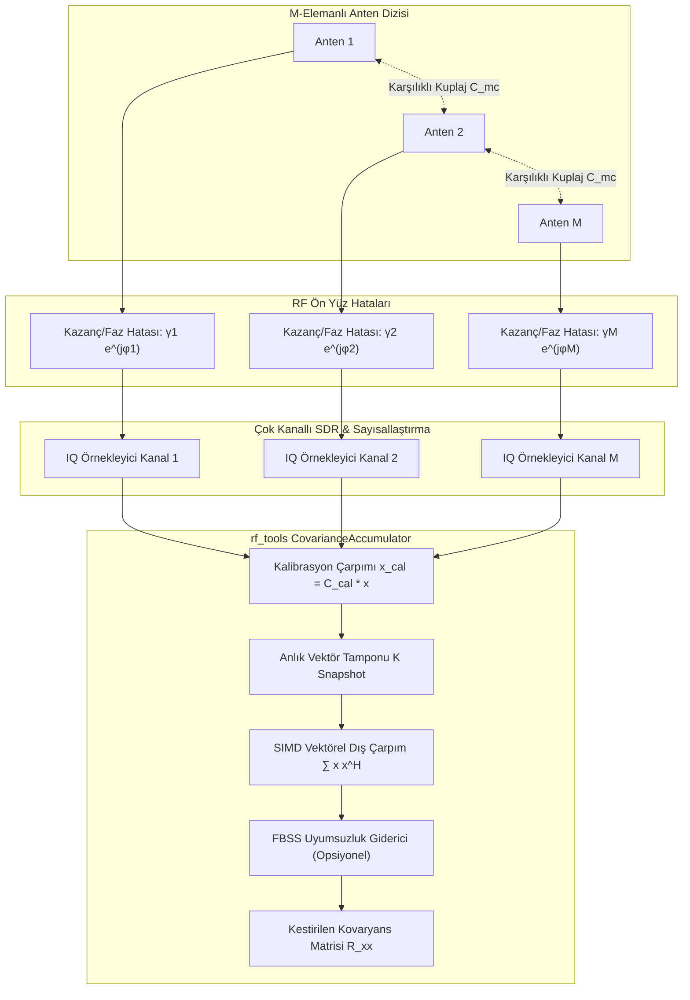
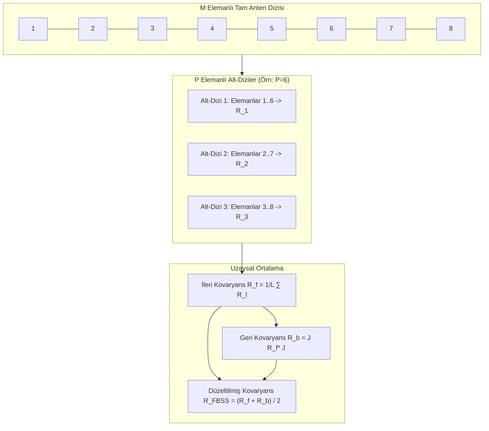

# Uzaysal Kovaryans Akümülatörü ve Çok Kanallı Dizi Kalibrasyonu: Gerçek Zamanlı Örneklem Kovaryansı ve Faz/Kazanç Telafisi
## Çok Kanallı SDR IQ Akışları, İstatistiksel Sapma Analizi ve Karşılıklı Kuplaj Düzeltimi

**Yazar:** Süleyman Poyraz  
**Proje:** `rf_tools` Module for SDR++  
**Doküman Kodu:** SDRPP-RF-DOC-02  
**İlgili Modüller:** `misc_modules/rf_tools/doa/`  

---

### Özet (Abstract)
Alt-uzay tabanlı süper-çözünürlüklü yön bulma (DOA) algoritmalarının başarımı, doğrudan alıcı anten dizisinin uzaysal kovaryans matrisinin ($\mathbf{R}_{xx} \in \mathbb{C}^{M \times M}$) kestirim doğruluğuna ve donanımsal kanal simetrisine bağlıdır. Çok kanallı Yazılım Tanımlı Radyo (SDR) platformlarında (örn. KrakenSDR, USRP TwinRX, senkronize edilmiş RTL-SDR dizileri); bağımsız yerel osilatör (LO) faz kaymaları, sıcaklığa bağlı analog kazanç sürüklenmeleri, RF kablo uzunluk farkları ve anten elemanları arasındaki elektromanyetik karşılıklı kuplaj (mutual coupling), ideal yönlendirme vektörünü (manifold) bozar. Kalibre edilmemiş faz/kazanç hataları, sinyal ve gürültü alt-uzaylarının birbirine sızmasına (subspace leakage) yol açarak MUSIC spektrumunda sahte tepelere ve yön bulma kestiriminde ciddi sapmalara neden olur.

Bu teknik şartnamede; `rf_tools` modülü için geliştirilen **Uzaysal Kovaryans Akümülatörü ve Dizi Kalibrasyon Motoru** incelenmektedir. Çalışmada, dar bant dizi sinyal modeli, sonlu anlık görüntü (finite snapshots) altında örneklem kovaryans matrisinin Karmaşık Wishart istatistiği, durağan olmayan RF ortamları için üstel unutma faktörlü (exponential forgetting) çevrimiçi yinelemeli birikim, anten karşılıklı kuplajı ile RF ön yüz kazanç/faz uyumsuzluklarının matematiksel kalibrasyon matrisi ($\mathbf{C}_{\text{cal}}$) ve uyumlu (coherent) çokyollu yansımaları çözmek amacıyla geliştirilen İleri-Geri Uzaysal Düzeltme (Forward-Backward Spatial Smoothing - FBSS) algoritması ayrıntılandırılmıştır.

---

## 1. Dizi Sinyal Modeli ve Kuramsal Kovaryans (Array Signal Model)

$M$ elemanlı keyfi geometrili bir anten dizisine, uzak alandan (far-field) gelen $D$ adet dar bantlı sinyal ulaştığı varsayılmaktadır ($D < M$).



### 1.1 Dar Bant Dizi Modeli
$n$. zaman anında anten dizisi terminallerinde ölçülen karmaşık taban bant sinyal vektörü $\mathbf{x}[n] \in \mathbb{C}^M$:
$$\mathbf{x}[n] = \mathbf{A}(\boldsymbol{\theta})\mathbf{s}[n] + \mathbf{w}[n]$$
Burada:
- $\mathbf{s}[n] = [s_1[n], s_2[n], \dots, s_D[n]]^T \in \mathbb{C}^D$ verici kaynak sinyalleridir.
- $\mathbf{A}(\boldsymbol{\theta}) = [\mathbf{a}(\theta_1), \mathbf{a}(\theta_2), \dots, \mathbf{a}(\theta_D)] \in \mathbb{C}^{M \times D}$ dizi yönlendirme matrisidir (array manifold).
- $\mathbf{w}[n] \sim \mathcal{CN}(\mathbf{0}, \sigma^2 \mathbf{I}_M)$ uzaysal ve zamansal olarak beyaz, sıfır ortalamalı karmaşık dairesel simetrik Gauss gürültüsüdür.

### 1.2 Teorik Uzaysal Kovaryans Matrisi
Sinyal vektörü $\mathbf{s}[n]$ ile gürültü $\mathbf{w}[n]$'nin istatistiksel olarak birbirinden bağımsız olduğu varsayımı altında, $\mathbf{x}[n]$'nin teorik uzaysal kovaryans matrisi $\mathbf{R}_{xx} \in \mathbb{C}^{M \times M}$:
$$\mathbf{R}_{xx} = \mathbb{E}\left[ \mathbf{x}[n]\mathbf{x}^H[n] \right] = \mathbf{A}(\boldsymbol{\theta}) \mathbf{R}_{ss} \mathbf{A}^H(\boldsymbol{\theta}) + \sigma^2 \mathbf{I}_M$$
Burada $\mathbf{R}_{ss} = \mathbb{E}\left[ \mathbf{s}[n]\mathbf{s}^H[n] \right] \in \mathbb{C}^{D \times D}$ kaynak kovaryans matrisidir. Kaynaklar birbirleriyle ilintisiz (uncorrelated) olduğunda $\mathbf{R}_{ss} = \mathrm{diag}(P_1, P_2, \dots, P_D)$ tam dereceye ($\mathrm{rank}(\mathbf{R}_{ss}) = D$) sahiptir.

---

## 2. Sonlu Örneklem Kovaryansı ve İstatistiksel Sapmalar (Sample Covariance & Wishart)

Pratikte sonsuz beklenen değer $\mathbb{E}[\cdot]$ hesaplanamaz; bunun yerine $K$ adet anlık görüntü (snapshot) üzerinden örneklem kovaryans matrisi $\hat{\mathbf{R}}_{xx}$ hesaplanır:
$$\hat{\mathbf{R}}_{xx} = \frac{1}{K} \sum_{n=1}^K \mathbf{x}[n]\mathbf{x}^H[n]$$

### 2.1 Karmaşık Wishart Dağılımı ve Varyans
$\mathbf{X} = [\mathbf{x}[1], \dots, \mathbf{x}[K]] \in \mathbb{C}^{M \times K}$ anlık görüntü matrisi olmak üzere, $K \hat{\mathbf{R}}_{xx} = \mathbf{X}\mathbf{X}^H$ matrisi $K$ serbestlik derecesine sahip merkezi Karmaşık Wishart dağılımına uyar:
$$K \hat{\mathbf{R}}_{xx} \sim \mathcal{CW}_M(K, \mathbf{R}_{xx})$$
- $\hat{\mathbf{R}}_{xx}$ tarafsız (unbiased) bir kestiricidir: $\mathbb{E}[\hat{\mathbf{R}}_{xx}] = \mathbf{R}_{xx}$.
- Kestirim matrisinin elemanlar arası varyansı $K$ ile ters orantılıdır:
  $$\mathrm{Var}\left( [\hat{\mathbf{R}}_{xx}]_{ij} \right) = \frac{1}{K} [\mathbf{R}_{xx}]_{ii} [\mathbf{R}_{xx}]_{jj}$$

### 2.2 Alt-Uzay Sızıntısı (Subspace Leakage) ve Eşik Kırılımı (Threshold Breakdown)
M. Shaghaghi ve S. A. Vorobyov (2015 [5]) tarafından kanıtlandığı üzere, küçük anlık görüntü sayılarında ($K \approx M$) veya düşük SNR seviyelerinde, örneklem kovaryans matrisi $\hat{\mathbf{R}}_{xx}$ gerçek kovaryans matrisinden önemli ölçüde sapar.
Bu sapma neticesinde gerçek sinyal alt-uzayı $\mathbf{U}_S$'in bir kısmı, gürültü alt-uzayı $\hat{\mathbf{U}}_N$'e sızar:
$$\hat{\mathbf{U}}_N^H \mathbf{A}(\boldsymbol{\theta}) \ne \mathbf{0} \quad (\text{Subspace Leakage})$$
Bu durum, MUSIC paydasının sıfıra yaklaşmasını engelleyerek yön spektrumunun çözünürlüğünü dramatik şekilde düşürür ve Root-MUSIC köklerinin birim çemberden uzaklaşmasına ("root-swap" anomalisi) sebep olur. Bu kırılımı engellemek için sistem mimarisinde asgari anlık görüntü koşulu $K \ge 2M$ (tercihen $K \ge 64$) olarak belirlenmiştir.

---

## 3. Dinamik Çevrimiçi Güncelleme: Üstel Unutma (Recursive Exponential Forgetting)

Hareketli verici platformların (İHA, uçak, araç) takibinde veya zamanla değişen çokyollu kanal koşullarında sabit blok ortalaması almak yerine, üstel unutma faktörlü yinelemeli güncelleme uygulanır:
$$\hat{\mathbf{R}}_{xx}[n] = \alpha \, \hat{\mathbf{R}}_{xx}[n-1] + (1 - \alpha) \, \mathbf{x}[n]\mathbf{x}^H[n]$$
Burada $\alpha \in [0.95, 0.999]$ unutma faktörüdür (forgetting factor). Etkin pencere uzunluğu (effective snapshot memory):
$$K_{\text{eff}} \approx \frac{1}{1 - \alpha}$$
Örneğin $\alpha = 0.99$ seçildiğinde, akümülatör son $K_{\text{eff}} \approx 100$ örneğin ağırlıklı hafızasını tutar; bu da $2.4\text{ MS/s}$ hızında yaklaşık $41.6\,\mu\text{s}$'lik anlık bir tepki süresi sağlar.

---

## 4. Donanımsal Bozulmalar ve Faz/Kazanç Kalibrasyonu (Array Calibration)

Gerçek dünyadaki çok kanallı SDR alıcılarında ölçülen anlık vektör $\mathbf{x}_{\text{raw}}[n]$, ideal sinyal modelinden üç temel fiziksel etki sebebiyle sapar:


### 4.1 Bozunma Modeli (Impairment Model)
1. **Kazanç Dengesizliği:** Her RF kanalındaki LNA ve mikser kazanç farkları:
   $$\mathbf{\Gamma} = \mathrm{diag}(\gamma_1, \gamma_2, \dots, \gamma_M), \quad \gamma_m \in \mathbb{R}^+$$
2. **Faz Kayması:** LO faz offsetleri ve farklı koaksiyel kablo gecikmeleri:
   $$\mathbf{\Phi} = \mathrm{diag}(e^{j\phi_1}, e^{j\phi_2}, \dots, e^{j\phi_M}), \quad \phi_m \in [-\pi, \pi)$$
3. **Karşılıklı Kuplaj (Mutual Coupling):** Anten elemanlarının birbirine yakın yerleşimi nedeniyle aralarında oluşan elektromanyetik re-radyasyon etkileşimi:
   $$\mathbf{C}_{mc} = (\mathbf{Z}_A + Z_L \mathbf{I})^{-1} (Z_A + Z_L)$$
   Burada $\mathbf{Z}_A$ anten empedans matrisidir. Düzgün Doğrusal Dizilerde $\mathbf{C}_{mc}$ simetrik Toeplitz matris formundadır.

Tüm bu etkilerin bileşkesi tek bir kalibrasyon matrisi $\mathbf{T}$ altında toplanır:
$$\mathbf{T} = \mathbf{C}_{mc} \, \mathbf{\Gamma} \, \mathbf{\Phi} \in \mathbb{C}^{M \times M}$$
Ölçülen anlık vektör:
$$\mathbf{x}_{\text{raw}}[n] = \mathbf{T} \mathbf{A}(\boldsymbol{\theta})\mathbf{s}[n] + \mathbf{w}[n]$$

### 4.2 Kalibrasyon Matrisinin Çıkarımı ve Telafisi
Bilinmeyen $\mathbf{T}$ matrisi, bilinen bir referans yönden $\theta_{\text{cal}}$ gönderilen tek bir kalibrasyon sinyali veya KrakenSDR'da olduğu gibi dahili gürültü kaynağının (noise source) tüm kanallara eşit fazda anahtarlanmasıyla ($\theta_{\text{cal}} = 0$) kestirilir.
Referans kanal $m=1$ olarak seçildiğinde ($[\mathbf{T}]_{11} = 1$), ölçülen yanıt vektörü $\mathbf{v}_{\text{cal}} \in \mathbb{C}^M$:
$$\mathbf{v}_{\text{cal}} = \mathbf{T} \mathbf{a}(\theta_{\text{cal}})$$
Buradan düzeltme matrisi $\mathbf{C}_{\text{cal}} = \mathbf{T}^{-1}$ oluşturulur. Kalibre edilmiş anlık vektör ve kovaryans matrisi:
$$\mathbf{x}_{\text{cal}}[n] = \mathbf{C}_{\text{cal}} \, \mathbf{x}_{\text{raw}}[n]$$
$$\hat{\mathbf{R}}_{\text{cal}} = \mathbf{C}_{\text{cal}} \, \hat{\mathbf{R}}_{\text{raw}} \, \mathbf{C}_{\text{cal}}^H$$
Bu doğrusal dönüşüm, dizi manifoldunu yeniden ideal analitik formuna indirgeyerek MUSIC ve Root-MUSIC algoritmalarının doğrudan uygulanabilmesini sağlar.

---

## 5. Uyumlu Sinyaller için İleri-Geri Uzaysal Düzeltme (FBSS)

Klasik MUSIC ve Root-MUSIC algoritmaları, gelen sinyallerin istatistiksel olarak ilintisiz olduğunu ($\mathrm{rank}(\mathbf{R}_{ss}) = D$) varsayar. Ancak şehir içi veya dağlık arazideki çokyollu yansımalar (multipath) veya radar karıştırma (smart jamming) durumunda, aynı vericiden gelen sinyaller birbiriyle tam uyumludur (coherent: $s_2[n] = \beta s_1[n]$). Bu durumda $\mathrm{rank}(\mathbf{R}_{ss}) < D$ olur ve sinyal alt-uzayı çöker; algoritma yansımaları birbirinden ayıramaz.

Bu kısıtı aşmak amacıyla, Shan vd. (1985 [9]) tarafından önerilen ve Bie vd. (2026 [6]) tarafından güncel dizi mimarilerine uyarlanan **İleri-Geri Uzaysal Düzeltme (Forward-Backward Spatial Smoothing - FBSS)** tekniği akümülatöre entegre edilmiştir.



### 5.1 FBSS Matematiksel Formülasyonu
$M$ elemanlı bir ULA, her biri $P$ elemana sahip $L = M - P + 1$ adet çakışan alt-diziye (subarray) bölünür:
1. **İleri Düzeltme (Forward Smoothing):** $l$. alt-dizinin anlık vektörü $\mathbf{x}_l[n] = [x_l[n], \dots, x_{l+P-1}[n]]^T$ olmak üzere:
   $$\mathbf{R}_f = \frac{1}{L} \sum_{l=1}^L \mathbf{R}_l, \quad \mathbf{R}_l = \frac{1}{K} \sum_{n=1}^K \mathbf{x}_l[n]\mathbf{x}_l^H[n]$$
2. **Geri Düzeltme (Backward Smoothing):** Değişim matrisi $\mathbf{J}_P \in \mathbb{R}^{P \times P}$ (ikincil köşegen elemanları 1, diğerleri 0) kullanılarak:
   $$\mathbf{R}_b = \mathbf{J}_P \, \mathbf{R}_f^* \, \mathbf{J}_P$$
3. **Bileşik İleri-Geri Kovaryans:**
   $$\mathbf{R}_{\text{FBSS}} = \frac{1}{2} \left( \mathbf{R}_f + \mathbf{R}_b \right) \in \mathbb{C}^{P \times P}$$

**Teorem:** $L \ge D$ alt-dizi kullanıldığında, kaynaklar arasında $\%100$ uyum (tam koherens) bulunsa dahi $\mathrm{rank}(\mathbf{R}_{\text{FBSS}}) = D$ garanti edilir; böylece alt-uzay çökmesi engellenir. Dizi açıklığının $M$'den $P$'ye düşmesi karşılığında çokyollu bağışıklığı elde edilir.

---

## 6. C++ Yazılım Tasarımı ve Veri Yapıları (C++ Architecture)

`rf_tools` bünyesindeki `CovarianceAccumulator` sınıfı, yukarıdaki matematiksel modeli SIMD vektörizasyonu ve sıfır-kopyalama prensipleriyle hayata geçirir:

```cpp
#pragma once
#include <Eigen/Dense>
#include <complex>
#include <vector>

template <size_t M>
class CovarianceAccumulator {
public:
    using ComplexVector = Eigen::Matrix<std::complex<float>, M, 1>;
    using ComplexMatrix = Eigen::Matrix<std::complex<float>, M, M>;

    CovarianceAccumulator(size_t window_size = 256, float forgetting_factor = 0.0f)
        : window_size_(window_size),
          alpha_(forgetting_factor),
          snapshot_count_(0),
          use_recursive_(forgetting_factor > 0.0f) {
        Rxx_.setZero();
        C_cal_.setIdentity();
    }

    // Kanal bazlı kalibrasyon katsayılarını uygula
    void setCalibrationMatrix(const ComplexMatrix& C_cal) noexcept {
        C_cal_ = C_cal;
    }

    // Anlık vektörü besle ve kovaryansı güncelle
    void feedSnapshot(const ComplexVector& raw_x) noexcept {
        ComplexVector x_cal = C_cal_ * raw_x;

        if (use_recursive_) {
            // Üstel unutmalı çevrimiçi güncelleme
            Rxx_ = alpha_ * Rxx_ + (1.0f - alpha_) * (x_cal * x_cal.adjoint());
            snapshot_count_++;
        } else {
            // Blok birikimi (SIMD Rank-1 Hermitian güncelleme)
            Rxx_.template selfadjointView<Eigen::Upper>().rankUpdate(x_cal);
            snapshot_count_++;
        }
    }

    // Blok dolduğunda normalize edilmiş kovaryansı döndür
    bool getNormalizedCovariance(ComplexMatrix& out_Rxx) noexcept {
        if (!use_recursive_ && snapshot_count_ < window_size_) {
            return false;
        }
        
        // Üst üçgeni alt üçgene kopyalayarak tam Hermitian matris üret
        out_Rxx = Rxx_.template selfadjointView<Eigen::Upper>();
        if (!use_recursive_) {
            out_Rxx /= static_cast<float>(snapshot_count_);
            Rxx_.setZero();
            snapshot_count_ = 0;
        }
        return true;
    }

    void reset() noexcept {
        Rxx_.setZero();
        snapshot_count_ = 0;
    }

private:
    ComplexMatrix Rxx_;
    ComplexMatrix C_cal_;
    size_t window_size_;
    float alpha_;
    size_t snapshot_count_;
    bool use_recursive_;

public:
    EIGEN_MAKE_ALIGNED_OPERATOR_NEW
};
```

---

## 7. Kaynakça ve Literatür Referansları (References)

- [1] R. O. Schmidt, "Multiple emitter location and signal parameter estimation," *IEEE Trans. Antennas Propag.*, vol. 34, no. 3, pp. 276–280, 1986. doi: [10.1109/TAP.1986.1143830](https://doi.org/10.1109/TAP.1986.1143830)
- [2] B. Friedlander and A. J. Weiss, "Eigenstructure methods for direction finding with sensor gain and phase uncertainties," *Circuits, Systems, and Signal Process.*, vol. 9, no. 1, pp. 1–17, 1990. doi: [10.1007/BF01201083](https://doi.org/10.1007/BF01201083)
- [3] I. J. Gupta and K. S. Ksienski, "Effect of mutual coupling on the performance of adaptive arrays," *IEEE Trans. Antennas Propag.*, vol. 31, no. 5, pp. 785–791, 1983. doi: [10.1109/TAP.1983.1143128](https://doi.org/10.1109/TAP.1983.1143128)
- [4] A. A. Salama, "Direction of Arrival Estimation: A Tutorial Survey of Classical and Modern Methods," *arXiv preprint arXiv:2508.11675 [eess.SP]*, 2025. URL: https://arxiv.org/abs/2508.11675
- [5] M. Shaghaghi and S. A. Vorobyov, "Subspace Leakage Analysis and Improved DOA Estimation with Small Sample Size," *IEEE Trans. Signal Processing*, vol. 63, no. 12, pp. 3251–3265, 2015. doi: [10.1109/TSP.2015.2422675](https://doi.org/10.1109/TSP.2015.2422675), arXiv: [1502.00139](https://arxiv.org/abs/1502.00139).
- [6] B. Bie, Y. Chen, H. Chen, and N. Li, "Coherent Signal DOA Estimation and 3D Point Cloud Imaging Based on a Straight-Curved Hybrid L-Shaped Conformal Array," *Sensors*, vol. 26, no. 17, p. 5445, 2026. PMCID: [PMC13568084](https://europepmc.org/articles/PMC13568084), doi: [10.3390/s26175445](https://doi.org/10.3390/s26175445).
- [7] J. Li et al., "Multipath Credibility Selection for Robust UWB Angle-of-Arrival Estimation in Narrow Underground Corridors," *Sensors*, vol. 26, no. 6, p. 2002, 2026. PMCID: [PMC13030765](https://europepmc.org/articles/PMC13030765), doi: [10.3390/s26062002](https://doi.org/10.3390/s26062002).
- [8] D. H. Shmuel, J. P. Merkofer, G. Revach, R. J. G. van Sloun, and N. Shlezinger, "SubspaceNet: Deep Learning-Aided Subspace Methods for DoA Estimation," *arXiv preprint arXiv:2306.02271 [eess.SP]*, 2023. URL: https://arxiv.org/abs/2306.02271
- [9] T. Shan, M. Wax, and T. Kailath, "On spatial smoothing for direction-of-arrival estimation of coherent signals," *IEEE Trans. Acoust., Speech, Signal Process.*, vol. 33, no. 4, pp. 806–811, 1985. doi: [10.1109/TASSP.1985.1164649](https://doi.org/10.1109/TASSP.1985.1164649)
