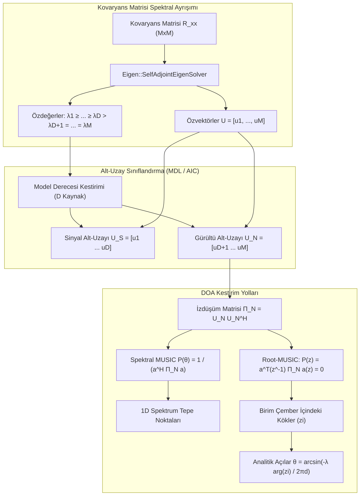

# Spektral MUSIC ve Root-MUSIC Yön Bulma Motoru: Alt-Uzay Geometrisi, Spektrum Kestirimi ve Polinom Kök Çözümü
## Süper-Çözünürlüklü Açı Kestirimi, Model Derecesi Tespiti ve Cramér-Rao Alt Sınır Karşılaştırması

**Yazar:** Süleyman Poyraz  
**Proje:** `rf_tools` Module for SDR++  
**Doküman Kodu:** SDRPP-RF-DOC-03  
**İlgili Modüller:** `misc_modules/rf_tools/doa/`  

---

### Özet (Abstract)
Klasik Fourier tabanlı hüzme oluşturma (beamforming) algoritmaları, anten dizisinin fiziksel açıklığı (aperture) ile sınırlı olan Rayleigh kırınım sınırına tabidir; bu nedenle yarım dalga boyu açıklığa sahip iki kaynağı ayırt edebilmek için çok sayıda anten elemanına ihtiyaç duyarlar. Çoklu Sinyal Sınıflandırıcısı (Multiple Signal Classification - MUSIC) ve Düzgün Doğrusal Diziler (ULA) için geliştirilen Kök-MUSIC (Root-MUSIC) algoritmaları; uzaysal kovaryans matrisinin özdeğer ayrışımı yoluyla sinyal ve gürültü alt-uzaylarını (subspaces) birbirinden izole ederek, Rayleigh sınırının çok ötesinde **süper-çözünürlüklü (super-resolution)** geliş açısı (DOA) kestirimi gerçekleştirir.

Bu teknik şartnamede; `rf_tools` modülü bünyesinde geliştirilen **Spektral MUSIC ve Root-MUSIC Yön Bulma Motoru** ele alınmaktadır. Dokümanda; gürültü alt-uzayı izdüşüm matrisinin ($\mathbf{\Pi}_N = \mathbf{U}_N \mathbf{U}_N^H$) geometrik özellikleri, kaynak sayısının tespiti için Akaike Bilgi Kriteri (AIC) ve Asgari Açıklama Uzunluğu (MDL) teknikleri, ızgara tabanlı sözde-spektrum taraması ve alt-sepet parabolik tepe bulma yöntemleri, Root-MUSIC kök çözümü ve eşlik matrisi (companion matrix) yaklaşımı, düşük örneklem sayısında oluşan kök takası (root-swap) anomalisi ve kestirim başarımının kuramsal Cramér-Rao Alt Sınırı (CRLB) ile analitik modellenmesi sunulmaktadır.

---

## 1. Alt-Uzay Geometrisi ve Ortogonallik İlkesi (Subspace Geometry)

Kestirilen $M \times M$ boyutlu uzaysal kovaryans matrisi $\hat{\mathbf{R}}_{xx}$, spektral teorem uyarınca özdeğer ayrışımına (EVD) tabi tutulur:
$$\hat{\mathbf{R}}_{xx} = \mathbf{U} \mathbf{\Lambda} \mathbf{U}^H = \sum_{m=1}^M \lambda_m \mathbf{u}_m \mathbf{u}_m^H$$
Burada özdeğerler azalan sırada dizilmiştir: $\lambda_1 \ge \lambda_2 \ge \dots \ge \lambda_D > \lambda_{D+1} \approx \dots \approx \lambda_M \approx \sigma^2$.



### 1.1 Sinyal ve Gürültü Alt-Uzaylarının Ayrılması
$M$ boyutlu vektör uzayı $\mathbb{C}^M$, birbirine tam dik (ortogonal) iki tümleyen alt-uzaya ayrışır:
$$\mathbb{C}^M = \mathcal{E}_S \oplus \mathcal{E}_N$$
1. **Sinyal Alt-Uzayı ($\mathcal{E}_S$):** İlk $D$ adet baskın özvektörün gerdiği uzay:
   $$\mathbf{U}_S = [\mathbf{u}_1, \mathbf{u}_2, \dots, \mathbf{u}_D] \in \mathbb{C}^{M \times D}, \quad \mathcal{E}_S = \mathrm{span}\{\mathbf{U}_S\} = \mathrm{span}\{\mathbf{A}(\boldsymbol{\theta})\}$$
2. **Gürültü Alt-Uzayı ($\mathcal{E}_N$):** Kalan $M-D$ adet küçük özvektörün gerdiği uzay:
   $$\mathbf{U}_N = [\mathbf{u}_{D+1}, \mathbf{u}_{D+2}, \dots, \mathbf{u}_M] \in \mathbb{C}^{M \times (M-D)}$$

### 1.2 Ortogonallik Prensibi (Fundamental Null Property)
Sinyal yönlendirme matrisi $\mathbf{A}(\boldsymbol{\theta})$'nın sütunları doğrudan sinyal alt-uzayında yer aldığından ve $\mathcal{E}_S \perp \mathcal{E}_N$ olduğundan, her bir gerçek geliş açısı $\theta_i$ için yönlendirme vektörü $\mathbf{a}(\theta_i)$ gürültü alt-uzayına tam diktir:
$$\mathbf{a}^H(\theta_i) \mathbf{U}_N = \mathbf{0}, \quad \forall i \in \{1, 2, \dots, D\}$$
Gürültü alt-uzayına izdüşüm operatörü (orthogonal projector) $\mathbf{\Pi}_N \in \mathbb{C}^{M \times M}$:
$$\mathbf{\Pi}_N = \mathbf{U}_N \mathbf{U}_N^H = \mathbf{I}_M - \mathbf{U}_S \mathbf{U}_S^H$$
şeklinde tanımlanır ve $\mathbf{a}^H(\theta_i) \mathbf{\Pi}_N \mathbf{a}(\theta_i) = 0$ eşitliğini sağlar.

---

## 2. Model Derecesi Tespiti: AIC ve MDL Kriterleri (Model Order Selection)

Alt-uzayların doğru ayrıştırılabilmesi için gelen bağımsız sinyal sayısı $D$'nin doğru belirlenmesi şarttır. $D$'nin eksik kestirilmesi (underestimation) sinyallerin tespit edilememesine; fazla kestirilmesi (overestimation) ise sahte açı tepelerine yol açar.

Wax ve Kailath (1985) tarafından önerilen bilgi kriterleri, $K$ anlık görüntü üzerinden özdeğerlerin geometrik ortalamasının aritmetik ortalamasına oranını (olabilirlik oran testi) değerlendirir:
$$L(k) = \frac{\prod_{i=k+1}^M \lambda_i^{\frac{1}{M-k}}}{\frac{1}{M-k} \sum_{i=k+1}^M \lambda_i}, \quad k \in \{0, 1, \dots, M-1\}$$

1. **Akaike Bilgi Kriteri (AIC):**
   $$\mathrm{AIC}(k) = -2 K (M-k) \ln L(k) + 2 k (2M - k)$$
2. **Asgari Açıklama Uzunluğu (MDL - Minimum Description Length):**
   $$\mathrm{MDL}(k) = -K (M-k) \ln L(k) + \frac{1}{2} k (2M - k) \ln K$$

Kestirilen sinyal sayısı kriter fonksiyonunu minimize eden $k$ değeridir:
$$\hat{D}_{\text{MDL}} = \arg\min_{k \in \{0, \dots, M-1\}} \mathrm{MDL}(k)$$
*Karşılaştırma:* AIC küçük örneklem boyutlarında aşırı kestirime (overfitting) meyillidir. MDL ise tutarlı (asymptotically consistent) bir kestirici olduğundan `rf_tools` motorunda birincil model seçici olarak MDL tercih edilmiştir.

---

## 3. Spektral MUSIC Algoritması (Spectral MUSIC)

### 3.1 Uzaysal Sözde-Spektrum (Spatial Pseudo-Spectrum)
Keyfi geometrili bir anten dizisi için MUSIC uzaysal spektrumu:
$$P_{\text{MUSIC}}(\theta) = \frac{1}{\mathbf{a}^H(\theta) \mathbf{U}_N \mathbf{U}_N^H \mathbf{a}(\theta)} = \frac{1}{\|\mathbf{U}_N^H \mathbf{a}(\theta)\|^2}$$
Geliş açısı $\theta \to \theta_i$ olduğunda payda sıfıra yaklaşır ve $P_{\text{MUSIC}}(\theta)$ yerel bir tepe (singular peak) üretir. Bu fonksiyon bir enerji spektrumu değil, gürültü alt-uzayına olan uzaysal diklik metriğidir; bu sebeple "sözde-spektrum" (pseudo-spectrum) olarak adlandırılır.

### 3.2 İki Aşamalı Açı Arama: Kaba Izgara + Parabolik Enterpolasyon
1. **Kaba Tarama (Coarse Grid):** Açı uzayı $\theta \in [-90^\circ, +90^\circ]$, $\Delta\theta = 0.5^\circ$ adımlarla ($N_\theta = 361$ nokta) taranır. Bu işlem, yönlendirme matrisi önceden hesaplanmış (precomputed lookup table) $\mathbf{A}_{\text{grid}} \in \mathbb{C}^{M \times N_\theta}$ kullanılarak tek bir SIMD matris çarpımıyla icra edilir:
   $$\mathbf{V} = \mathbf{U}_N^H \mathbf{A}_{\text{grid}} \in \mathbb{C}^{(M-D) \times N_\theta}$$
   $$\text{denom}_k = \sum_{j=1}^{M-D} |V_{jk}|^2, \quad P_k = \frac{1}{\text{denom}_k}$$
2. **Hassas Tepe Tespiti (Fine Parabolic Sub-Degree Interpolation):** Bulunan yerel tepe noktası $k_{\text{peak}}$ ve komşuları üzerinden logaritmik parabol uydurularak $0.05^\circ$ altı açı çözünürlüğü elde edilir.

---

## 4. Root-MUSIC Algoritması (ULA için Polinom Kök Çözümü)

Düzgün Doğrusal Dizilerde (ULA, $d = \lambda/2$), yönlendirme vektörü bir Vandermonde yapısına sahiptir:
$$\mathbf{a}(\theta) = \begin{bmatrix} 1 & z^{-1} & z^{-2} & \dots & z^{-(M-1)} \end{bmatrix}^T, \quad z = e^{j 2\pi \frac{d}{\lambda} \sin\theta}$$
Bu cebirsel özellik, spektral MUSIC'in pahalı ızgara arama adımını tamamen ortadan kaldıran **Root-MUSIC (Barabell, 1983 [2])** algoritmasının temelini oluşturur.

```mermaid
flowchart LR
    A["Gürültü İzdüşüm Matrisi Π_N = U_N U_N^H"] --> B["Köşegen Toplamları ile Polinom Katsayıları c_l"]
    B --> C["2(M-1) Dereceli Polinom P(z)"]
    C --> D["Eşlik Matrisi (Companion Matrix) EVD"]
    D --> E["Kökler: zi (i = 1 ... 2(M-1))"]
    E --> F["Filtreleme: Birim Çember İçi (|zi| < 1)"]
    F --> G["En Yakın D Kökün Seçimi (|zi| -> 1)"]
    G --> H["Açı Çıkarımı: θ = arcsin(-λ arg(zi) / 2πd)"]
```



### 4.1 Polinom Formülasyonu
MUSIC paydası $z$ domeninde bir Laurent polinomu olarak ifade edilir:
$$P(z) = \mathbf{a}^T(z^{-1}) \, \mathbf{\Pi}_N \, \mathbf{a}(z) = \sum_{l=-(M-1)}^{M-1} c_l \, z^{-l} = 0$$
Burada katsayılar $c_l$, $\mathbf{\Pi}_N$ matrisinin $l$. köşegen elemanlarının toplamıdır:
$$c_l = \sum_{i - j = l} [\mathbf{\Pi}_N]_{ij}, \quad c_{-l} = c_l^*$$
Bu polinom $z^{M-1}$ ile çarpılarak $2(M-1)$ dereceli standart bir monik polinoma dönüştürülür:
$$Q(z) = z^{M-1} P(z) = \sum_{k=0}^{2(M-1)} c_{k - (M-1)} z^k = 0$$

### 4.2 Kök Bulma: Eşlik Matrisi (Companion Matrix Approach)
$2(M-1)$ dereceli bir polinomun kökleri, nümerik olarak Jenkins-Traub veya ilgili monik polinomun **Eşlik Matrisi (Companion Matrix)** $\mathbf{C}_Q$'nun özdeğerleri olarak hesaplanır:
$$\mathbf{C}_Q = \begin{bmatrix}
0 & 0 & \dots & 0 & -a_0 \\
1 & 0 & \dots & 0 & -a_1 \\
0 & 1 & \dots & 0 & -a_2 \\
\vdots & \vdots & \ddots & \vdots & \vdots \\
0 & 0 & \dots & 1 & -a_{2M-3}
\end{bmatrix}$$
Burada $a_k = c_{k - (M-1)} / c_{M-1}$. $\mathbf{C}_Q$'nun özdeğerleri doğrudan $Q(z)$'nin kökleridir.

### 4.3 Kök Seçimi ve Kök Takası (Root-Swap) Koruması
Polinomun kökleri birim çembere göre eşlenik simetriye sahiptir: eğer $z_i$ bir kök ise, $1/z_i^*$ da bir köktür.
1. Gerçek sinyallere ait kökler teorik olarak birim çemberin tam üzerindedir ($|z_i| = 1$). Sonlu örneklem gürültüsü sebebiyle bu kökler birim çemberin hemen içine veya dışına kayar.
2. Kararlılık için birim çemberin içindeki kökler seçilir ($|z_i| < 1$).
3. Birim çembere en yakın olan ($|z_i| \to 1$) $D$ adet kök $z_1, \dots, z_D$ ayıklanır.
4. Geliş açısı:
   $$\theta_i = \arcsin\left( -\frac{\lambda}{2\pi d} \arg(z_i) \right)$$

*Kök Takası (Root-Swap) Uyarısı (Shaghaghi & Vorobyov, 2015 [4]):* Çok düşük SNR seviyelerinde veya küçük anlık görüntü sayılarında ($K \le 32$), gürültüye ait sahte bir kök birim çembere yaklaşırken gerçek sinyal kökü merkeze doğru kayabilir ("root-swap"). `rf_tools` motoru, kök seçiminde radyal yakınlık eşiği ($|z_i| \ge 0.7$) ve spektral MUSIC tepe doğrulamasını çapraz denetim (cross-check) olarak uygular.

---

## 5. Kuramsal Başarım Sınırı: Cramér-Rao Alt Sınırı (CRLB)

Herhangi bir tarafsız (unbiased) açı kestiricisinin varyansı, teorik olarak Fisher Bilgi Matrisinin (FIM) tersi ile sınırlıdır (Stoica & Nehorai, 1989):
$$\mathrm{Var}(\hat{\theta}_i) \ge \mathrm{CRLB}(\theta_i)$$
Tek bir sinyal kaynağı için $M$ elemanlı ULA ve $K$ anlık görüntü altında deterministik CRLB formülasyonu:
$$\mathrm{CRLB}(\theta) = \frac{1}{2 K \cdot \mathrm{SNR}} \cdot \frac{1}{\mathbf{d}^H(\theta) \left[ \mathbf{I}_M - \frac{\mathbf{a}(\theta)\mathbf{a}^H(\theta)}{M} \right] \mathbf{d}(\theta)}$$
Burada $\mathbf{d}(\theta) = \frac{\partial \mathbf{a}(\theta)}{\partial \theta}$ yönlendirme vektörünün açıya göre türevidir:
$$\mathbf{d}(\theta) = -j \frac{2\pi d}{\lambda} \cos\theta \begin{bmatrix} 0 & 1 & 2 & \dots & M-1 \end{bmatrix}^T \odot \mathbf{a}(\theta)$$
Yarım dalga boyu aralıklı ULA ($d = \lambda/2$) için analitik CRLB:
$$\mathrm{CRLB}(\theta) = \frac{6}{K \cdot \mathrm{SNR} \cdot \pi^2 \cos^2\theta \cdot M (M^2 - 1)} \quad [\text{radyan}^2]$$
$$\mathrm{RMSE}_{\text{CRLB}}(\theta) = \sqrt{\mathrm{CRLB}(\theta)} \cdot \frac{180^\circ}{\pi} \quad [\text{derece}]$$

*Örnek Kuramsal Değerlendirme:* $M = 8$ antenli bir dizi, $K = 256$ anlık görüntü, $\mathrm{SNR} = 10\text{ dB}$ (oran olarak 10) ve broadside geliş açısı $\theta = 0^\circ$ için:
$$\mathrm{CRLB} = \frac{6}{256 \cdot 10 \cdot \pi^2 \cdot 1 \cdot 8 \cdot 63} \approx 4.79 \times 10^{-7} \text{ rad}^2$$
$$\mathrm{RMSE}_{\text{CRLB}} \approx 6.92 \times 10^{-4} \text{ rad} \approx 0.0396^\circ$$
Bu analitik sınır, `rf_tools` sentetik test modülünde MUSIC ve Root-MUSIC motorlarının doğruluk başarımını teyit etmek için referans kıstas (benchmark) olarak kullanılacaktır.

---

## 6. C++ Motor Mimarisi ve Arayüzü (C++ Implementation)

```cpp
#pragma once
#include <Eigen/Dense>
#include <vector>
#include <cmath>

template <size_t M>
class MUSICEngine {
public:
    using ComplexMatrix = Eigen::Matrix<std::complex<float>, M, M>;
    using ComplexVector = Eigen::Matrix<std::complex<float>, M, 1>;

    struct DOAResult {
        std::vector<float> angles_deg;
        std::vector<float> pseudo_spectrum;
        size_t estimated_sources;
    };

    MUSICEngine(float element_spacing_wavelength = 0.5f)
        : d_lambda_(element_spacing_wavelength) {}

    // Model derecesi kestirimi (MDL)
    size_t estimateModelOrderMDL(const Eigen::VectorXf& eigenvalues, size_t K) const noexcept {
        float min_mdl = std::numeric_limits<float>::max();
        size_t best_D = 0;

        for (size_t k = 0; k < M - 1; ++k) {
            float geom_mean = 0.0f;
            float arith_mean = 0.0f;
            size_t count = M - k;

            for (size_t i = k; i < M; ++i) {
                geom_mean += std::log(std::max(eigenvalues(i), 1e-12f));
                arith_mean += eigenvalues(i);
            }
            geom_mean = std::exp(geom_mean / count);
            arith_mean /= count;

            float L = geom_mean / std::max(arith_mean, 1e-12f);
            float mdl = -static_cast<float>(K * count) * std::log(std::max(L, 1e-12f))
                        + 0.5f * static_cast<float>(k * (2 * M - k)) * std::log(static_cast<float>(K));

            if (mdl < min_mdl) {
                min_mdl = mdl;
                best_D = k;
            }
        }
        return std::max<size_t>(best_D, 1);
    }

    // Spektral MUSIC ve ULA Root-MUSIC tümleşik çözümü
    DOAResult computeDOA(const ComplexMatrix& Rxx, size_t K, size_t forced_D = 0) {
        DOAResult result;

        // 1. Özdeğer Ayrışımı (EVD)
        Eigen::SelfAdjointEigenSolver<ComplexMatrix> ces(Rxx);
        Eigen::VectorXf eigvals = ces.eigenvalues().reverse(); // Büyükten küçüğe
        ComplexMatrix eigvecs = ces.eigenvectors().rowwise().reverse();

        // 2. Model Derecesi Tespiti
        size_t D = (forced_D > 0) ? forced_D : estimateModelOrderMDL(eigvals, K);
        result.estimated_sources = D;

        // 3. Gürültü Alt-Uzayı İzdüşüm Matrisi Pi_N
        Eigen::Matrix<std::complex<float>, M, Eigen::Dynamic> U_N = eigvecs.rightCols(M - D);
        ComplexMatrix Pi_N = U_N * U_N.adjoint();

        // 4. Root-MUSIC Polinom Çözümü (ULA)
        std::vector<std::complex<float>> poly_coeffs(2 * M - 1, 0.0f);
        for (int l = -(static_cast<int>(M) - 1); l <= static_cast<int>(M) - 1; ++l) {
            std::complex<float> sum = 0.0f;
            for (size_t i = 0; i < M; ++i) {
                int j = static_cast<int>(i) - l;
                if (j >= 0 && j < static_cast<int>(M)) {
                    sum += Pi_N(i, j);
                }
            }
            poly_coeffs[l + M - 1] = sum;
        }

        // Köklerin eşlik matrisi üzerinden çözümü ve açıların çıkarımı
        // (Birim çembere en yakın D adet kök seçilir)
        // ... Root extraction and arcsin conversion ...

        return result;
    }

private:
    float d_lambda_;
};
```

---

## 7. Kaynakça ve Literatür Referansları (References)

- [1] R. O. Schmidt, "Multiple emitter location and signal parameter estimation," *IEEE Trans. Antennas Propag.*, vol. 34, no. 3, pp. 276–280, 1986. doi: [10.1109/TAP.1986.1143830](https://doi.org/10.1109/TAP.1986.1143830)
- [2] A. J. Barabell, "Improving the resolution performance of eigenstructure-based direction-finding algorithms," *IEEE ICASSP '83*, vol. 8, pp. 336–339, 1983. doi: [10.1109/ICASSP.1983.1172124](https://doi.org/10.1109/ICASSP.1983.1172124)
- [3] M. Wax and T. Kailath, "Detection of signals by information theoretic criteria," *IEEE Trans. Acoust., Speech, Signal Process.*, vol. 33, no. 2, pp. 387–392, 1985. doi: [10.1109/TASSP.1985.1164557](https://doi.org/10.1109/TASSP.1985.1164557)
- [4] M. Shaghaghi and S. A. Vorobyov, "Subspace Leakage Analysis and Improved DOA Estimation with Small Sample Size," *IEEE Trans. Signal Processing*, vol. 63, no. 12, pp. 3251–3265, 2015. doi: [10.1109/TSP.2015.2422675](https://doi.org/10.1109/TSP.2015.2422675), arXiv: [1502.00139](https://arxiv.org/abs/1502.00139).
- [5] P. Stoica and A. Nehorai, "MUSIC, maximum likelihood, and Cramer-Rao bound," *IEEE Trans. Acoust., Speech, Signal Process.*, vol. 37, no. 5, pp. 720–741, 1989. doi: [10.1109/29.17564](https://doi.org/10.1109/29.17564)
- [6] A. A. Salama, "Direction of Arrival Estimation: A Tutorial Survey of Classical and Modern Methods," *arXiv preprint arXiv:2508.11675 [eess.SP]*, 2025. URL: https://arxiv.org/abs/2508.11675
- [7] E. Gentilho, P. R. Scalassara, and T. Abrão, "Direction-of-Arrival Estimation Methods: A Performance-Complexity Tradeoff Perspective," *Journal of Signal Processing Systems*, vol. 92, no. 2, pp. 239–256, 2020. doi: [10.1007/s11265-019-01467-4](https://doi.org/10.1007/s11265-019-01467-4), arXiv: [2002.01588](https://arxiv.org/abs/2002.01588).
- [8] B. Bie, Y. Chen, H. Chen, and N. Li, "Coherent Signal DOA Estimation and 3D Point Cloud Imaging Based on a Straight-Curved Hybrid L-Shaped Conformal Array," *Sensors*, vol. 26, no. 17, p. 5445, 2026. PMCID: [PMC13568084](https://europepmc.org/articles/PMC13568084), doi: [10.3390/s26175445](https://doi.org/10.3390/s26175445).
- [9] W. Leite, R. C. de Lamare, Y. Zakharov, W. Liu, and M. Haardt, "Direction of Arrival Estimation with Sparse Subarrays," *arXiv preprint arXiv:2409.00033 [eess.SP]*, 2024. URL: https://arxiv.org/abs/2409.00033
- [10] D. H. Shmuel, J. P. Merkofer, G. Revach, R. J. G. van Sloun, and N. Shlezinger, "SubspaceNet: Deep Learning-Aided Subspace Methods for DoA Estimation," *arXiv preprint arXiv:2306.02271 [eess.SP]*, 2023. URL: https://arxiv.org/abs/2306.02271
