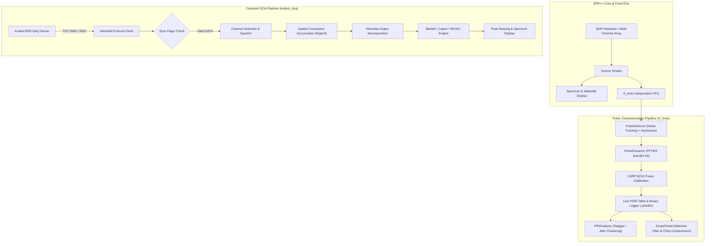

# SDRSentinel

**Advanced Passive RF Signal Characterization, Pulse Analysis (PDW), and Direction Finding Suite**  
*Built on the high-performance, modular [SDR++](https://github.com/AlexandreRouma/SDRPlusPlus) engine.*

---

## About SDRSentinel and Heritage

**SDRSentinel** is an extended, specialized distribution of **SDR++** designed for passive RF spectrum surveillance, electronic intelligence (ELINT / EW), radar pulse characterization, and coherent multi-channel Direction of Arrival (DOA) estimation.

SDR++ (originally authored by Alexandre Rouma and contributors) provides an ultra-lightweight, modular, and bloat-free SDR receiver foundation with broad hardware support. SDRSentinel preserves full backward compatibility with SDR++ sources and signal processing modules while integrating native, high-performance C++17 DSP pipelines that eliminate the Python and runtime overhead typical of GNU Radio workflows (`gr-pdw`, `gr-doa`).

> [!NOTE]
> **Preserved SDR++ Documentation:**  
> The original SDR++ README, installation instructions, full contributor list, and community links are preserved in [README_SDRPlusPlus.md](README_SDRPlusPlus.md).

---

## Key Features

### 1. Real-Time Radar Pulse Characterization (`rf_tools`)
* **Dynamic Energy Detection:** Low-latency pulse detector featuring single-pole exponential moving average (EMA) noise floor tracking with 3 dB hysteresis to eliminate false boundary splits.
* **Precise Parameter Extraction (PDW):**
  * Time of Arrival (TOA) and Pulse Width (PW) with sample-accurate bounds.
  * Peak and average pulse power (dBFS) and SNR relative to the pre-pulse noise floor.
  * Sub-bin carrier frequency estimation using zero-padded FFTW3 and 3-point parabolic peak interpolation.
* **Calibrated RF Power (dBm):** Embedded empirical GTRI power calibration tables from `gr-pdw` for Ettus USRP B210 (70 MHz – 6.0 GHz, supporting RX2 and TX/RX ports). Clear visual notifications when uncalibrated sources are connected.

### 2. PRI Analysis & Emitter Deinterleaving
* **Statistical PRI Clustering:** Automatically categorizes pulse trains into **Constant**, **Stagger**, and **Jitter** classes based on coefficient of variation and density clustering.
* **Live Histograms:** Interactive ImGui distribution plots for Pulse Repetition Interval (PRI), Pulse Width (PW), and frequency offset ($\Delta f$).
* **Multi-Track Emitter Tracker:** Groups intercepted pulses into distinct emitter tracks based on frequency and duration tolerances.

### 3. Intra-Pulse Modulation Analysis (MOP Scope)
* **Signal Inspector:** Detailed time-domain envelope ($I$, $Q$), instantaneous frequency trajectory, and Short-Time Fourier Transform (STFT) spectrogram.
* **Chirp Matched Filter (Pulse Compression):**
  * Live radar pulse compression engine supporting Linear Frequency Modulation (LFM).
  * Windowing functions: Rectangular, Hamming, and Hann for sidelobe suppression.
  * Real-time readouts for compression ratio, SNR processing gain, and Peak Sidelobe Ratio (PSLR).
  * Executed on the GUI thread to guarantee thread safety and prevent DSP thread stalls.

### 4. Coherent Multi-Channel Direction Finding (`kraken_doa`)
* **KrakenSDR Heimdall Client:** High-speed native TCP client connecting directly to the Heimdall DAQ server (port 5000 for coherent IQ data, port 5001 for remote control).
* **Frame Synchronization Gating:** Strict filtering ensures DOA estimates are derived **only** from valid DATA frames with verified sample delay and phase synchronization (`delay_sync` and `iq_sync` flags).
* **Super-Resolution Algorithms:**
  * **Bartlett** (conventional beamformer)
  * **Capon** (Minimum Variance Distortionless Response - MVDR)
  * **MUSIC** (Multiple Signal Classification)
* **Array Geometries:** Supports Uniform Circular Arrays (UCA, 0°–360° unambiguous coverage) and Uniform Linear Arrays (ULA).
* **Live Visualizer:** Real-time polar compass, spatial pseudo-spectrum, peak quality metric, eigenvalue decomposition display, and compass offset correction.

### 5. Scalar S21 & Resonator Q-Factor Analysis
* **Touchstone & CSV Import:** Ingests S21 magnitude traces from external vector network analyzers (NanoVNA, `.s2p` files in RI/MA/DB formats, or CSV).
* **Live Receiver Scalar Sweep:** Performs $|S_{21}|$ sweeps using any SDR++ receiver paired with a tracking generator or broadband noise source (Thru $\rightarrow$ DUT $\rightarrow$ Noise Floor normalization).
* **Rigorous Validation:** Flags fits as `[NOT VALIDATED]` unless adequate dynamic range ($\ge 20\text{ dB}$), noise floor margins, and sampling point densities across the $-3\text{ dB}$ dip are satisfied.

### 6. High-Throughput Binary Streaming & gr-pdw / SigMF Export
* **Continuous Streaming (`.pdwbin`):** Zero-copy binary logging with microsecond-accurate time bases and true sample rates.
* **gr-pdw HDF5 Compatibility:** Automated Python conversion tool ([`tools/read_sdrpp_pdw.py`](misc_modules/rf_tools/tools/read_sdrpp_pdw.py)) maps `.pdwbin` captures directly to `gr-pdw` HDF5 schemas.
* **Standards Support:** Full exports to CSV, JSON session dumps, and SigMF recording metadata.

### 7. Enhanced UI & Workflow
* **ImGui Docking System:** Modular, detachable dock panels with persistent layout configuration across restarts.
* **Waterfall Click Guard:** Transparent mouse handling prevents accidental VFO and spectrum re-tuning while interacting with floating windows.
* **Full Hardware Support:** Complete driver compatibility with RTL-SDR, HackRF, Airspy, BladeRF, LimeSDR, PlutoSDR, USRP, HydraSDR, and SoapySDR.

---

## Architecture Overview



---

## Documentation

Comprehensive technical specifications and operating instructions are provided in the [`docs/`](docs/) directory:

| Document | Title & Description |
|---|---|
| [**SDRPP-RF-DOC-00**](docs/00_master_thesis_passive_rf_analysis_roadmap.md) | **Master Specification & Theoretical Roadmap:** Academic background, mathematical formulations (MUSIC, Root-MUSIC, CRLB), and verification methodology. |
| [**SDRPP-RF-DOC-04**](docs/04_kullanim_kilavuzu.md) | **User Manual & Hardware Guide:** Step-by-step setup, RTL-SDR / B210 operations, KrakenSDR network topology, and troubleshooting. |
| [**ROADMAP.md**](ROADMAP.md) | **Implementation Roadmap & Audit Log:** Integration audit results, hardware benchmarks, and future milestones. |
| [**HEIMDALL_PROTOCOL.md**](misc_modules/kraken_doa/HEIMDALL_PROTOCOL.md) | **KrakenSDR Protocol Specification:** Wire protocol documentation for TCP 5000 IQ frames and TCP 5001 control. |
| [**README_SDRPlusPlus.md**](README_SDRPlusPlus.md) | **Original SDR++ Readme:** Original installation instructions, platform-specific build instructions, and credits. |

---

## Building from Source

### Dependencies

* **C++ Compiler:** C++17 compatible (GCC 9+, Clang 10+, MSVC 2019+)
* **CMake:** Version 3.13 or newer
* **Build System:** Ninja (recommended) or Make
* **Core Libraries:** `fftw3f`, `eigen3`, `glfw3`, `zstd`, `libusb`
* **Audio Backends:** `portaudio` or `rtaudio`

### Quick Build (macOS / Linux)

```bash
# 1. Clone the repository
git clone https://github.com/Zaryob/SDRPlusPlus.git SDRSentinel
cd SDRSentinel

# 2. Configure build with rf_tools and kraken_doa enabled
cmake -B build -G Ninja \
    -DCMAKE_BUILD_TYPE=Release \
    -DOPT_BUILD_RF_TOOLS=ON \
    -DOPT_BUILD_KRAKEN_DOA=ON

# 3. Compile
ninja -C build
```

### Running Test Suites

SDRSentinel includes a comprehensive automated test suite for DSP and protocol validation:

```bash
cd build

# Run pulse detection & parameter extraction tests
./misc_modules/rf_tools/test_rf_tools_pulse_detector
./misc_modules/rf_tools/test_root_dev_integration
./misc_modules/rf_tools/test_rf_tools_resonator

# Run KrakenSDR Heimdall protocol and DOA DSP tests
./misc_modules/kraken_doa/test_kraken_heimdall_header
./misc_modules/kraken_doa/test_kraken_heimdall_client
./misc_modules/kraken_doa/test_kraken_doa_dsp
./misc_modules/kraken_doa/test_kraken_doa_pipeline

# Run Python PDW binary-to-HDF5 roundtrip verification
uv run --no-project --with numpy --with h5py python ../misc_modules/rf_tools/tests/test_pdw_roundtrip.py ../test_output/pdw_test.pdwbin
```

---

## License & Credits

* **SDRSentinel** is licensed under the [GNU General Public License v3.0 (GPL-3.0)](license).
* **SDR++ Base Engine:** Created by Alexandre Rouma and the SDR++ contributor community. Full credits are preserved in [README_SDRPlusPlus.md](README_SDRPlusPlus.md).
* **PDW & Power Calibration:** Based on algorithms and empirical datasets from [gr-pdw](https://github.com/gtri/gr-pdw) by the Georgia Tech Research Institute (GTRI, GPLv3).
* **Direction Finding:** Mathematical foundation and steering vector formulations adapted from [gr-doa](https://github.com/EttusResearch/gr-doa) (GPLv3).
* **KrakenSDR DAQ Client:** Developed in accordance with the open Heimdall DAQ interface by KrakenRF (GPLv3).
* **Author / Maintainer:** Süleyman Poyraz (`zaryob.dev@gmail.com`).
